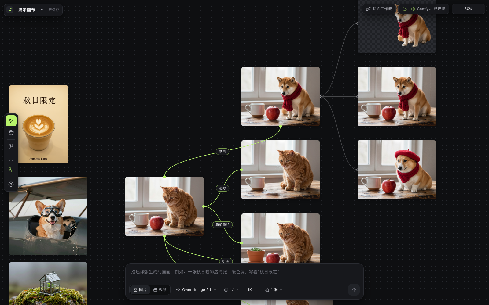
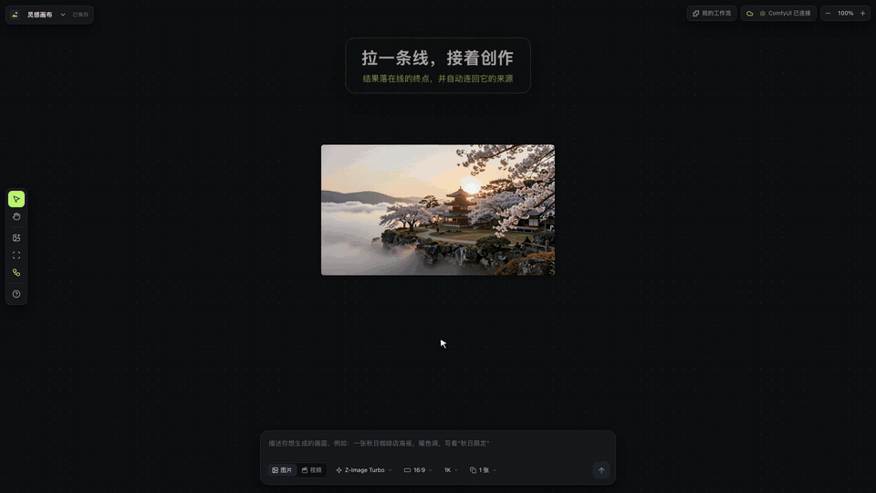
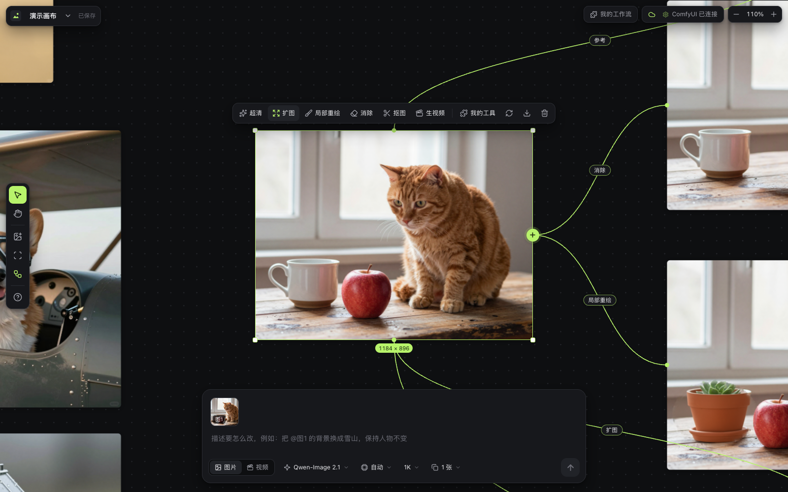
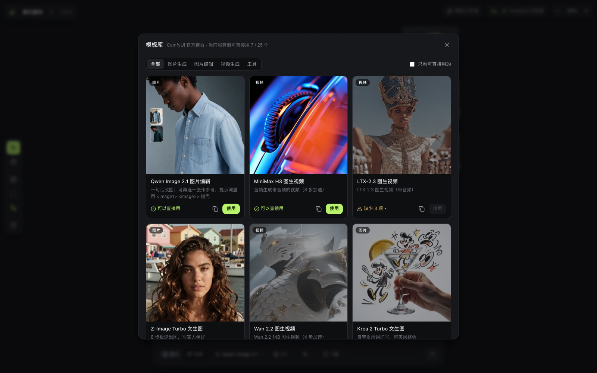
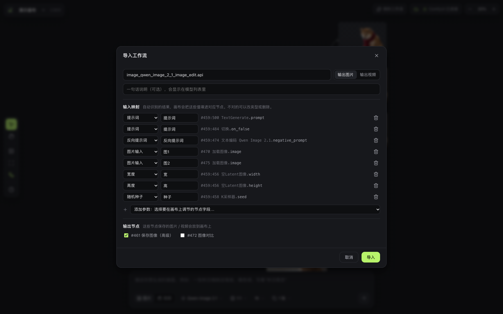
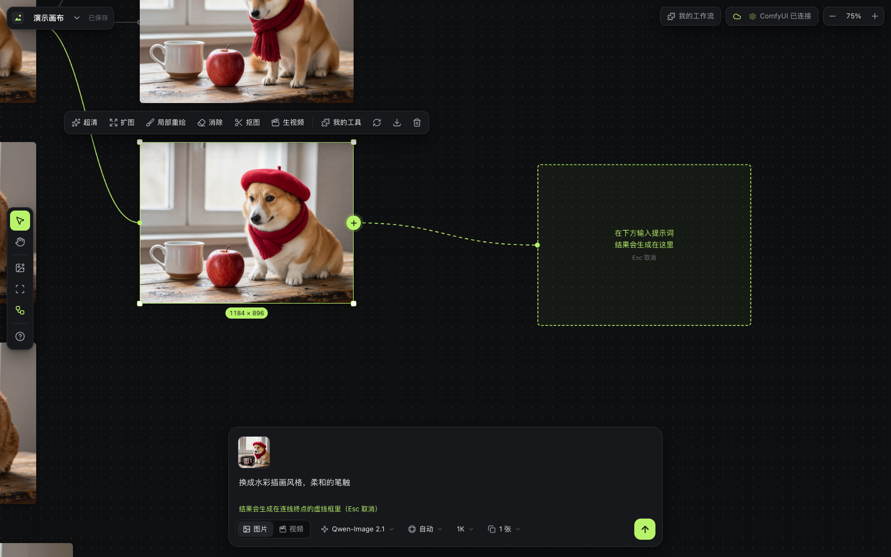

<div align="center">


# Infinode

**为 ComfyUI 深度适配的无限画布** · 生图、改图、生视频，每个结果都用连线连回它的来源

[功能](#功能) · [快速开始](#快速开始) · [画布助手](#画布助手) · [Claude Code / Codex](#用-claude-code--codex-操作画布mcp) · [官方模板](#官方模板) · [导入你的工作流](#导入你自己的工作流) · [许可证](#许可证) · [English](#english)



</div>

## 这是什么

ComfyUI 很强，但节点图不适合"边看边改"的创作。Infinode 是一个跑在你自己电脑上的网页画布：在底部写一句话出图，选中图片点一下就能改图、扩图、抠图、超清、生成视频，所有生成都交给**你自己的 ComfyUI** 完成。每个结果都会用一条线连回它的输入，整条创作链一目了然。

也可以让 AI 来操作画布：右上角的**画布助手**能听懂"把选中的图各做一段视频"这样的话，甚至从一句话做出一条多镜头短剧；你常用的 **Claude Code、Codex** 也能通过 MCP 直接读写画布、出图出视频。

Infinode 只做画布，不包含、也不分发任何模型。用哪个模型、哪个工作流，完全由你的 ComfyUI 决定；模型的许可证由使用者自己遵守，见[模型许可证](#模型许可证)。

名字来自 infinite + node：无限画布上的每个结果，都是一个连着来源的节点。

<div align="center">


▶ 完整宣传片见 [Releases](../../releases/latest)
</div>

## 功能

- **无限画布**：双指平移、捏合缩放、框选、拖拽缩放、撤销重做、复制粘贴；直接拖入或粘贴图片；大画布按视口加载节点和连线；支持搜索节点、提示词和文本后快速定位；自动保存，多画布切换
- **连线即工作流**：结果自动连回它的参考图 / 首帧 / 原图；悬停或选中时显示每条线的用途；从图片右侧的 `+` 拉出一条线，在终点生成下一步
- **资产库**：集中浏览上传和生成的图片、视频，按类型和使用状态筛选，并反查资产所在的项目
- **内置工具**：文生图、参考图编辑（多图）、局部重绘、消除、扩图、抠图（透明 PNG）、SeedVR2 超清、图生视频 / 文生视频 / 首尾帧 / 多图参考视频（MiniMax H3，自带声音）
- **25 个官方模板**：从 ComfyUI 官方模板转换的预设（Qwen-Image、Z-Image、Flux.2、Krea 2、LTX-2.3、Wan 2.2、MiniMax H3、SeedVR2 …），装好模型就能用；缺什么模型、下载地址、放哪个文件夹都会写出来
- **导入你自己的工作流**：ComfyUI 里「导出 (API)」得到的 JSON 拖进来，自动识别提示词、图片输入、种子、尺寸和参数，导入后就是画布上的新工具
- **本地部署**：页面和数据都在你自己的机器上；ComfyUI 可以在本机、局域网或远程服务器（支持自动 SSH 隧道）
- **首次使用诊断**：启动时检查本地服务、ComfyUI、画布助手和官方模板，缺什么可以直接进入设置处理
- **实时进度**：排队位置、当前阶段、进度条、已用时间，可随时取消，失败一键重试
- **画布助手**：右上角「助手」打开对话面板，用一句话让它读画布、看图、出图、出视频、运行你的工作流，结果照样连线；还能从一句话做到一条多镜头短剧（剧本 → 分镜 → 设定图 → 关键帧 → 视频 → 剪辑成片）。模型可用 DeepSeek 等，也可接任意 OpenAI 兼容接口
- **接入 Claude Code / Codex**：内置 MCP 服务，外部 agent 能用和画布助手同一套工具操作画布，你在页面上实时看到结果
- **文本节点**：剧本、分镜表、备注直接放在画布上，双击编辑
- **中英文界面**：默认跟随浏览器语言，可在设置里切换；服务端的提示和画布助手的回复也跟着变

<table>
<tr>
<td></td>
<td></td>
</tr>
<tr>
<td align="center">选中图片：超清 · 扩图 · 局部重绘 · 消除 · 抠图 · 生视频</td>
<td align="center">模板库：可用状态、缺失模型和下载地址</td>
</tr>
<tr>
<td></td>
<td></td>
</tr>
<tr>
<td align="center">导入工作流：自动识别输入，可手动调整</td>
<td align="center">从图片拉出一条线，在终点生成</td>
</tr>
</table>

## 快速开始

需要：

- [Node.js](https://nodejs.org/) 22.19 或更高
- 一个可以访问的 [ComfyUI](https://github.com/comfyanonymous/ComfyUI)（建议较新的版本，官方模板依赖新版自带的节点）
- 桌面浏览器（Chrome / Edge / Safari）
- 可选：[ffmpeg](https://ffmpeg.org/)，画布助手剪辑成片、查看视频画面时要用（macOS：`brew install ffmpeg`）

```bash
git clone <本仓库地址> infinode
cd infinode
npm install
npm run dev
```

打开 <http://localhost:5173>。点右上角的 ComfyUI 状态按钮进入**设置**，填入 ComfyUI 地址（本机默认 `http://127.0.0.1:8188`），测试通过后保存。

### 桌面端

项目也提供 Electron 桌面端。它会在本机启动 Infinode 服务并打开独立窗口，作品数据保存在系统的应用数据目录中，不需要手动打开浏览器：

```bash
npm install
npm run desktop:dev
```

生成可分发安装包：

```bash
npm run desktop:dist
```

`desktop:dist` 会按当前系统生成安装包；在 macOS、Windows 或 Linux 上分别运行即可生成对应平台的包。桌面端仍然连接你配置的本机、局域网或远程 ComfyUI。画布助手的 API 配置可以直接在「设置 → 画布助手模型」中填写；命令行启动也可以继续使用项目根目录的 `.env`。

发布版安装包会附在 [Releases](../../releases/latest) 页面，提供 macOS、Windows 和 Linux 下载。推送 `v*` 标签后，GitHub Actions 会自动构建并上传桌面端安装包；也可以在 Actions 中手动选择已有标签补发安装包。

### 产品网站

仓库中的 `site/` 是产品官网和交互演示，推送到 `main` 后会由 GitHub Actions 部署到 GitHub Pages。首次使用时，在仓库的 **Settings → Pages** 中将发布来源设为 **GitHub Actions**；本地预览可运行：

```bash
npm run site:build
python3 -m http.server 4173 --directory site
```

### 连接不同位置的 ComfyUI

| ComfyUI 在哪 | 怎么连 |
|---|---|
| 本机 | 默认地址 `http://127.0.0.1:8188`，不用改 |
| 局域网 / 服务器，可直接访问 | ComfyUI 启动时加 `--listen`，在设置里填 `http://服务器IP:8188` |
| 服务器，只监听它自己的 127.0.0.1 | 复制 `.env.example` 为 `.env`，填上 `SSH_HOST`（`~/.ssh/config` 里的主机别名，需免密登录）。`npm run dev` 会自动建立并保持 SSH 隧道 |

Infinode 的后端只监听本机（`127.0.0.1:8787`）。想让局域网里的其他设备也能用，在 `.env` 里设置 `HOST=0.0.0.0`，然后用 IP 地址或 `xxx.local` 打开；想用别的域名访问（比如经过反向代理），把它加进 `.env` 的 `ALLOWED_HOSTS`。注意后端没有登录验证，同一网络里的人都能使用和删除你的作品，只在你信任的网络里这样做，见 [SECURITY.md](SECURITY.md)。

## 使用

| 操作 | 方式 |
|---|---|
| 生成 | 底部输入框写提示词，选择图片 / 视频和模型，回车 |
| 参考图 / 首帧 | 先在画布上选中图片（可多选），再生成；提示词里用 `@图1`、`@图2` 指代 |
| 改图 | 选中图片，上方工具栏：超清、扩图、局部重绘、消除、抠图、生视频、我的工具 |
| 拉线生成 | 拖动图片右侧的 `+`，在空白处松开，结果会生成在虚线框里 |
| 平移 / 缩放 | 双指滑动或滚轮 / 双指捏合或 ⌘+滚轮；空格+拖动 |
| 搜索节点 | 左侧放大镜，搜索节点名称、提示词或文本，点击结果直接定位 |
| 预览 | 双击图片或视频（视频带声音） |
| 连线 | 悬停或选中图片高亮它的连线；`L` 显示 / 隐藏全部连线 |
| 其他 | `⌘Z` 撤销、`⌘D` 复制一份、`Delete` 删除、`⇧1` 显示全部、`/` 聚焦输入框 |
| 画布助手 | 右上角「助手」，用一句话说要做什么；发送时会带上画布上选中的节点 |
| 节点溯源 | 选中节点后右键「节点信息」，查看输入链路、生成参数、请求 JSON，并复制 ComfyUI 图谱 |
| 文本 | 左侧工具栏「添加文本」，双击编辑；支持简单的 Markdown 和表格 |

## 画布助手

右上角「助手」打开对话面板。它能看到画布上有什么、你选中了哪些节点，替你出图、改图、出视频、运行你导入的工作流，结果和你手动做的一样放在画布上并连好线。可以这样说：

- 「把选中的三张图各做一段 5 秒视频」
- 「用选中的人物图，生成他在雨夜街头的三张不同景别的照片」
- 「看看选中的图有没有问题，有问题就重新生成」

### 配置

助手用的是你自己的大模型 API key。推荐在「设置 → 画布助手模型」里填写模型 ID、OpenAI 兼容接口地址、API key、视觉输入和思考等级，保存后立即对新的对话生效。你还可以把「操作确认」设为“所有写入操作确认”，让助手在修改画布、提交生成或运行工作流前先展示确认卡片。API key 只保存在本机应用数据中，不会通过设置接口返回。也可以在项目根目录的 `.env` 里配置，然后重启 `npm run dev`：

```bash
DEEPSEEK_API_KEY=sk-...                   # 默认模型 deepseek/deepseek-flash（能看图）
# AGENT_MODEL=anthropic/claude-sonnet-5-5 # 也可以换成 pi-ai 支持的其它模型，配上对应的 key
# 或者任意 OpenAI 兼容接口（豆包、百炼、Ollama、vLLM…）：
# AGENT_BASE_URL=http://127.0.0.1:11434/v1
# AGENT_MODEL=qwen3:32b
# AGENT_API_KEY=...
# AGENT_VISION=1                          # 这个模型能看图
```

助手会把画布概况（节点名称、提示词、文本内容）和它查看的图片发给你配置的模型服务。key 只保存在你的机器上；把画布共享到局域网时，助手也只能在运行服务的那台电脑上使用。

### 做短剧

跟助手说故事和镜头，比如「做一个两个镜头的小短剧：深夜便利店门口，一个女孩在等人……」。它会按这个顺序做，每一步都留在画布上，你随时可以改：

1. 把**剧本**和**分镜表**写成画布上的文本节点，等你认可
2. 出**角色设定图**（白底全身照、正脸特写）和**场景图**
3. 每个镜头出一张**关键帧**，拼成一张图自己检查一遍，有问题的单独重做
4. 每个镜头生成一段**视频**：提交前面板上会弹出确认卡，写明段数和预计占用 GPU 多久，你点「开始」才会提交
5. 先听每段的台词在哪几秒，再按分镜**剪辑成片**，台词不会被剪掉

每一批跑完它会自动接着做，页面关了也照样进行；你可以随时插话、停止，或者说「重新剪一版」。

## 用 Claude Code / Codex 操作画布（MCP）

Infinode 的后端自带一个 MCP 服务，地址是 `http://127.0.0.1:8787/mcp`。Claude Code、Codex 这类 agent 接上以后，能用和画布助手同一套工具读画布、看图、出图出视频、写剧本、剪辑成片，你在页面上实时看到结果。先运行 `npm run dev`（或 `npm start`），再接入：

**Claude Code**

```bash
claude mcp add --transport http infinode http://127.0.0.1:8787/mcp
```

**Codex**

```bash
codex mcp add infinode --url http://127.0.0.1:8787/mcp
```

或者写进 `~/.codex/config.toml`：

```toml
[mcp_servers.infinode]
url = "http://127.0.0.1:8787/mcp"
tool_timeout_sec = 600   # 默认 60 秒；等出图、剪辑会更久
```

接好后直接说「看看我在 Infinode 里选中的图，帮它生成三个不同背景的版本」就行。

- **它知道你在看什么**：打开着的页面会把当前画布、选中的节点和视野位置告诉后端。外部 agent 先调用 `get_context`，就知道「这张」「选中的」指哪些节点；不指定画布时，默认操作你正在看的那张。新生成的节点放在你的视野里，画布会自动移过去。
- **哪些操作要你同意**：读画布、看图、等结果这类工具标注了只读，客户端可以直接放行；出图、出视频、剪辑会改动画布，按客户端的设置征求你同意。批量出视频很占 GPU，返回结果里会写明预计时长。
- **工具一览**：`get_context`、`list_boards`、`create_board`、`read_board`、`view_images`、`review_items`、`generate_image`、`batch_generate_images`、`generate_video`、`batch_generate_videos`、`list_workflows`、`run_workflow`、`wait_for_items`、`cancel_items`、`write_note`、`inspect_clips`、`assemble_video`。
- **只对本机开放**：`/mcp` 只接受同一台电脑上的连接；把画布共享到局域网时，别人也连不上。只支持 stdio 的客户端可以用 [mcp-remote](https://www.npmjs.com/package/mcp-remote) 转接：`npx mcp-remote http://127.0.0.1:8787/mcp`。

## 官方模板

模型列表里的「浏览模板库」收录了 25 个 ComfyUI 官方模板，按图片生成、图片编辑、视频生成、工具分类。每个模板会实时检查你的 ComfyUI：

- **可以直接用**：节点和模型都在，点「使用」即可
- **缺少 N 项**：列出缺少的模型、下载地址和应该放的 `models/…` 文件夹，或缺少的节点

模型名不完全一致也没关系：同一个模型的不同精度（int8 / bf16 / fp8）或放在子文件夹里的文件会被自动识别。

模板是用 `scripts/build-presets.ts` 把官方模板在 ComfyUI 前端里导出成 API 格式、再整理参数生成的，见 [CONTRIBUTING.md](CONTRIBUTING.md)。

## 导入你自己的工作流

1. 在 ComfyUI 里打开你的工作流，菜单「工作流 → 导出 (API)」（Workflow → Export (API)）
2. 在 Infinode 右上角「我的工作流」里导入这个 JSON
3. 检查自动识别的映射：提示词、反向提示词、图片 / 视频输入、种子、尺寸、比例……也可以把任意节点字段（步数、强度、LoRA 权重、下拉选项）暴露成画布上的参数
4. 保存后，它会出现在底部输入框的模型列表和图片工具栏的「我的工具」里

在 ComfyUI 里把节点标题改成下面的样子，导入时会按标题识别：

| 节点标题 | 含义 |
|---|---|
| `@prompt` / `@negative` | 提示词 / 反向提示词 |
| `@image`、`@image:人物` | 图片输入（冒号后是显示名称） |
| `@video` / `@mask` | 视频输入 / 蒙版 |
| `@seed` / `@size` / `@output` | 随机种子 / 输出尺寸 / 结果节点 |

工作流可以导出成 `.infinode.json` 分享给别人，对方直接导入即可。

## 内置工具用到的模型

内置工具会在你的 ComfyUI 里自动查找下列模型（不同精度和子文件夹都能识别），缺模型的工具会在设置页标出来：

| 工具 | 模型 | 模型许可证 |
|---|---|---|
| 文生图 / 参考图编辑 / 局部重绘 / 消除 / 扩图 / 抠图 | Qwen-Image 2.1（diffusion model + qwen3vl 8b 文本编码器 + VAE） | Qwen Research License：只允许研究和评估 |
| 极速文生图 | Z-Image Turbo（+ qwen_3_4b + ae VAE） | Apache 2.0 |
| 超清 | SeedVR2（需要 [ComfyUI-SeedVR2_VideoUpscaler](https://github.com/numz/ComfyUI-SeedVR2_VideoUpscaler) 节点） | Apache 2.0 |
| 视频 | MiniMax H3（fl2va / ref2va + qwen3vl 32b + 视频 / 音频 VAE，可选 turbo LoRA 加速） | MiniMax H3 Community License：可商用，有附加条件 |

### 模型许可证

Infinode 的许可证只管它自己的代码，你用的每个模型另有许可证，商用前要分别确认。内置工具用到的两个模型限制比较多：

- **Qwen-Image 2.1**：只允许研究和评估用途，商用要另外向模型方申请授权。需要商用的话，文生图和改图可以换用模板库里 Apache 2.0 的 Qwen-Image 2512、Qwen-Image-Edit 2511 或 Z-Image Turbo。
- **MiniMax H3**：可以商用，但商用产品的界面上要标明"MiniMax H3"，年收入超过 2000 万美元要另外取得授权。它的许可证**不覆盖美国、欧盟、英国和韩国**：在这些地区不能使用这个模型，也不能展示它生成的内容。

模板库里的模型：Z-Image Turbo、Qwen-Image 2512 / Edit 2509 / Edit 2511、FLUX.2 [klein] 4B、Wan 2.2、SeedVR2 是 Apache 2.0；FLUX.2 [dev]、FLUX.2 [klein] 9B、FLUX.1 Kontext [dev] 不能商用；LTX-2.3、Krea 2 是带条件的社区许可，SDXL 可商用但有使用限制条款。以各模型页面上的许可证原文为准。

### 商用模式

设置里打开「**只用可以商用的模型**」后，只允许研究用途或不能商用的模型会停用：内置的 Qwen-Image 2.1 生图和基于它的局部重绘、消除、扩图、抠图，以及模板库里的 FLUX.2 [dev] 等，界面上会写明原因。出图默认换成 Z-Image Turbo，改图请用模板库里标「可商用」的模板（如 Qwen-Image-Edit 2511）。画布助手和 MCP 也遵守这个设置。模型列表、模板库和设置页都标出了每个模型「可商用 / 有条件商用 / 不可商用」。

这些标注只覆盖内置工具和官方模板，你自己导入的工作流不受影响；标注仅供参考，以各模型页面上的许可证原文为准。

## 常见问题

**第一次生成特别慢？** ComfyUI 第一次用某个模型要从硬盘加载，可能要几分钟；之后在显存里就快了。图片模型和视频模型轮流用会反复加载。

**提示 fp8 不支持？** ComfyUI 用 `--enable-triton-backend` 启动时，RTX 40 系列以前的显卡（如 RTX 3090、A100）跑不了 fp8 模型。去掉这个参数，或换用 bf16 / int8 版本的模型。用到 fp8 模型的工具会被自动标为不可用。

**远程服务器上传图片很慢？** 本地图片第一次用作输入时需要传到服务器，取决于你的上行带宽，每张只传一次。画布上生成的结果本来就在服务器上，接着编辑不需要上传。

**数据存在哪？** 都在项目的 `data/` 目录：图片视频、画布、任务记录、导入的工作流、助手的对话，以及画布用的缩略图（`data/thumbs`，删掉会自动重新生成）。删掉整个 `data/` 即可清空。

**画布上节点很多会卡吗？** 画布只渲染视野附近的节点；节点在屏幕上显示得小的时候用缩略图和视频封面，放大到看得清细节时才加载原图和视频。一张有 70 多个节点、35 段视频的画布，缩到能看全的时候只需要加载约 1MB。

**生产部署？** `npm run build && npm start`，只占用一个端口（默认 `http://127.0.0.1:8787`）。

**助手提示没有配置 API key？** 在 `.env` 里加上对应的 key（DeepSeek 是 `DEEPSEEK_API_KEY`），然后重启 `npm run dev`。

**Codex 调用 Infinode 的工具时超时？** Codex 默认每次工具调用只等 60 秒。在 `config.toml` 里把 `tool_timeout_sec` 调大，或者让它分几次调用 `wait_for_items`（每次默认等 50 秒）。

**改了 `PORT`？** MCP 地址跟着变成 `http://127.0.0.1:<PORT>/mcp`。

## 许可证

Infinode 采用 [MIT 许可证](LICENSE)：个人和公司都可以免费使用、修改、分发，包括商用。

注意：MIT 只覆盖 Infinode 自己的代码。ComfyUI、自定义节点和模型各有自己的许可证，部分模型不允许商用，见[模型许可证](#模型许可证)；商用时可以在设置里打开「只用可以商用的模型」。`presets/` 中的模板来自 ComfyUI 官方模板（MIT），见 [THIRD_PARTY_NOTICES.md](THIRD_PARTY_NOTICES.md)。

欢迎参与贡献，请先阅读 [CONTRIBUTING.md](CONTRIBUTING.md)。

Infinode 是社区项目，与 Comfy Org 没有关联。ComfyUI 是 Comfy Org 的商标。

---

## English

**Infinode** is an infinite canvas built for ComfyUI. Type a prompt to generate, select an image to edit, extend, cut out, upscale or animate it, and every result stays linked to the inputs it was made from. All generation runs on **your own ComfyUI** (local, LAN or remote over an automatic SSH tunnel). Infinode only does the canvas: it does not include or distribute any models, so which models and workflows you run is up to you.

- Built-in tools: text-to-image, multi-reference editing, inpaint, erase, outpaint, background removal, SeedVR2 upscaling, image/text/first-last-frame/reference-to-video with native audio (MiniMax H3)
- 25 official ComfyUI templates as ready-made tools, with per-template model checks, download links and target folders
- Import any workflow from ComfyUI's **Export (API)**: prompts, image inputs, seed, size and parameters are detected and editable
- Drag a line out of an image to place the next generation exactly where you want it
- Canvas assistant: a chat panel that reads the board, looks at images, generates and runs your workflows, on DeepSeek, any other model [pi-ai](https://github.com/earendil-works/pi) supports, or any OpenAI-compatible endpoint (set the key in `.env`). It can take a short drama from a one-line idea to a cut: script and shot list as text notes, character and scene sheets, keyframes, one video per shot (after you approve the GPU time), then an edit (needs ffmpeg)
- Text notes on the board for scripts, shot lists and comments
- English and Chinese interface: follows your browser's language, switchable in Settings; server messages and the assistant's replies follow it
- A commercial-only switch in Settings turns off research-only and non-commercial models; every built-in tool and template is labeled with its license
- Built-in MCP server at `http://127.0.0.1:8787/mcp` (this machine only): Claude Code (`claude mcp add --transport http infinode http://127.0.0.1:8787/mcp`), Codex (`codex mcp add infinode --url http://127.0.0.1:8787/mcp`) and other agents get the same canvas tools as the assistant, and know which board and items you have selected in the page

```bash
git clone <this repository> infinode && cd infinode
npm install
npm run dev   # open http://localhost:5173, then set your ComfyUI address in Settings
```

An Electron desktop build is also available:

```bash
npm run desktop:dev   # run the app in a desktop window
npm run desktop:dist  # build an installer for the current platform
```

The desktop app starts the local Infinode server itself and keeps its data in the system application-data directory. The `site/` directory contains the product page and interactive walkthrough; GitHub Actions publishes it to GitHub Pages on every push to `main`.

Prebuilt installers are attached to the [latest GitHub Release](../../releases/latest) for macOS, Windows and Linux. Pushing a `v*` tag builds and uploads the desktop packages automatically; an existing tag can also be selected from the workflow to backfill its assets.

**Website:** [infinode online demo](https://xingchen-mu.github.io/infinode/) is a static product page with an interactive canvas walkthrough. It does not use a GPU; real generation still runs through your own ComfyUI in the desktop or self-hosted app.

**License:** [MIT](LICENSE), free for personal and commercial use.

**Model licenses are separate.** The built-in image tools use Qwen-Image 2.1, which is licensed for research and evaluation only. MiniMax H3 allows commercial use with conditions, but its license does not cover the US, the EU, the UK or South Korea: the model may not be used, nor its outputs displayed, there. Z-Image Turbo, Qwen-Image 2512 / Edit 2511, Wan 2.2 and SeedVR2 are Apache 2.0. Check each model's own license before use.

Infinode is a community project and is not affiliated with Comfy Org. ComfyUI is a trademark of Comfy Org.
